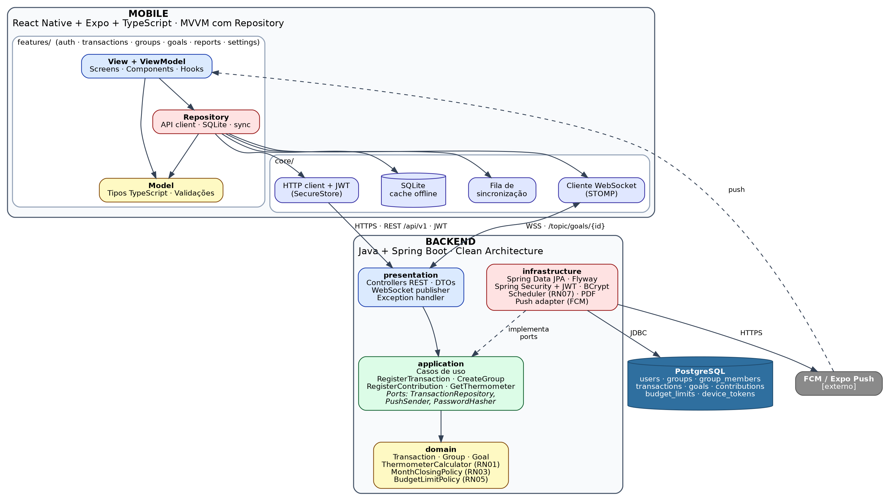
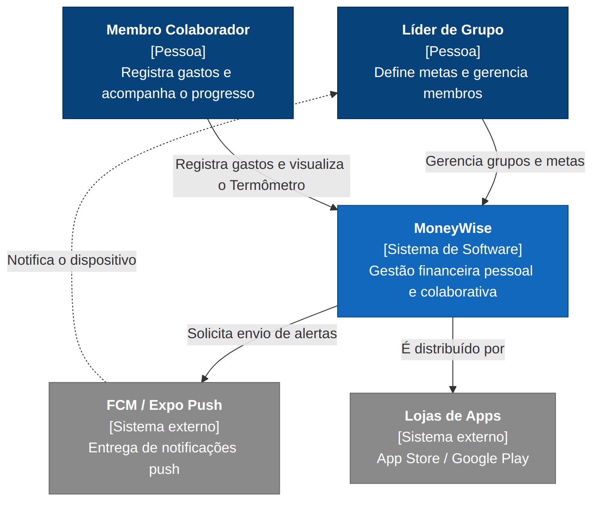
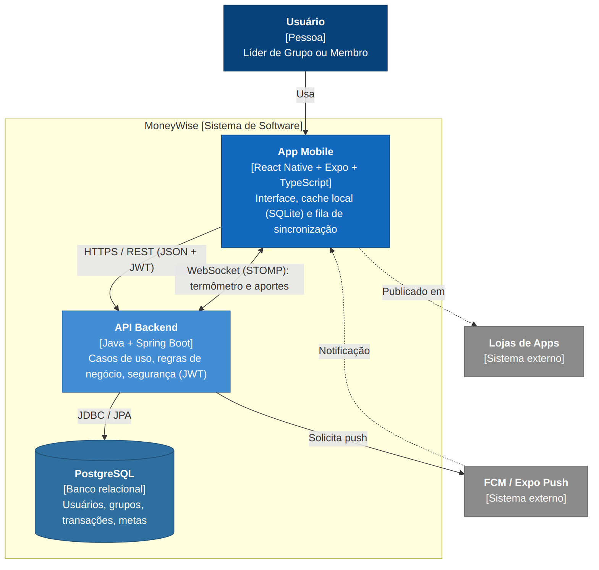
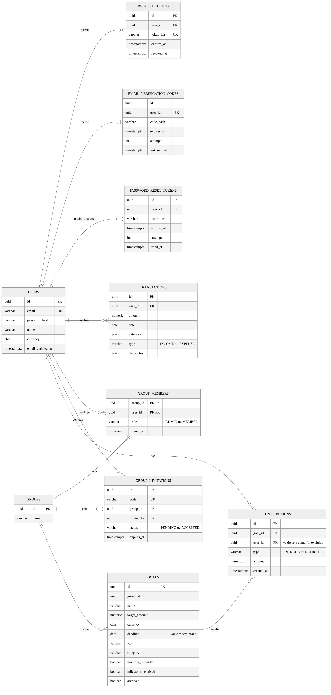
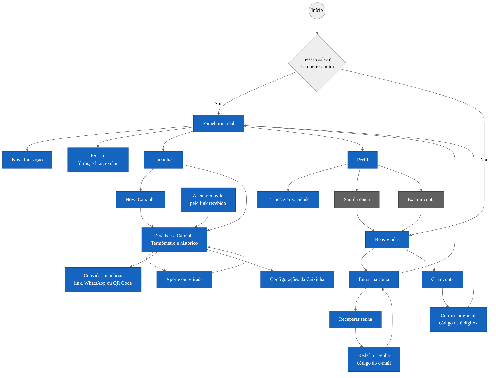
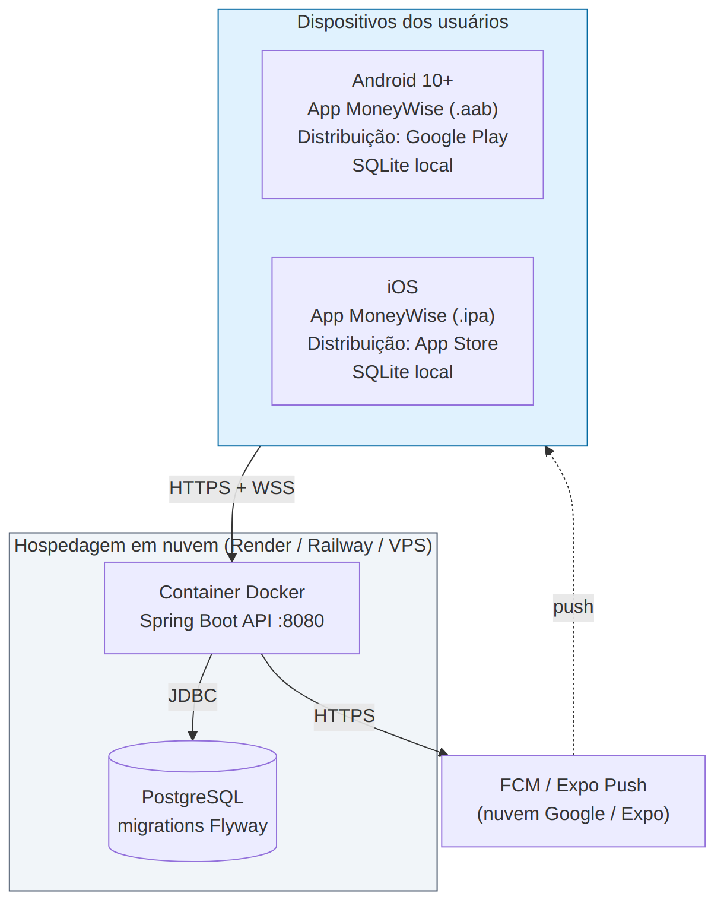

<div align="center">

# 💰 MoneyWise

**Finanças pessoais e colaborativas, com metas em grupo que você acompanha em tempo real.**

Trabalho de Conclusão de Curso · Engenharia de Software · Universidade Católica de Brasília


[Sobre](#-sobre-o-projeto) ·
[Funcionalidades](#-funcionalidades) ·
[Protótipo](#-protótipo) ·
[Arquitetura](#%EF%B8%8F-arquitetura) ·
[Como executar](#-como-executar) ·
[Roadmap](#%EF%B8%8F-roadmap) ·
[Contribuição](#-como-contribuir) ·
[Equipe](#-equipe) ·
[Documentação](#-documentação)

</div>

---

## 📖 Sobre o projeto

O **MoneyWise** é um sistema de gerenciamento de finanças pessoais e colaborativas pensado para jovens adultos, casais e famílias. Com ele, o usuário registra receitas e despesas, acompanha o próprio saldo e, junto com outras pessoas, cria **Caixinhas**: metas financeiras dentro de um grupo.

O diferencial do MoneyWise é o **Termômetro**, um indicador visual que mostra o progresso de cada Caixinha e é atualizado **em tempo real** para todos os membros do grupo sempre que alguém faz um aporte ou uma retirada.

O sistema é formado por:

- um **aplicativo móvel** para Android e iOS, que funciona também **sem internet** e sincroniza os dados quando a conexão volta;
- uma **API REST própria**, que concentra as regras de negócio, a segurança e a comunicação em tempo real;
- um **banco de dados relacional** com o esquema versionado.

> **Privacidade em primeiro lugar:** o saldo pessoal de um usuário nunca é mostrado aos outros membros do grupo. O grupo enxerga apenas os aportes e as retiradas feitos nas Caixinhas.

> **Distribuição:** nesta versão o aplicativo **não será publicado** na Google Play nem na App Store. Ele é instalado e apresentado pelo Expo (RN10).

---

## ✨ Funcionalidades

### Release 1 · MVP

| Módulo | O que o usuário pode fazer |
|---|---|
| 🔐 **Conta e acesso** | Criar conta aceitando os Termos de Uso, confirmar o e-mail com um código, entrar com "Lembrar de mim", recuperar a senha com um código enviado por e-mail, sair com segurança e excluir a própria conta |
| 💸 **Transações** | Registrar, editar, excluir e filtrar receitas e despesas por categoria e período, com categorias fixas (Comida, Transporte, Compras, Casa, Saúde e Outros) e categorias próprias |
| 📊 **Painel** | Ver saldo, entradas e saídas do mês e gastos por categoria |
| 📴 **Modo offline** | Registrar transações sem internet, com sincronização automática na reconexão |
| 👥 **Grupos** | Criar Caixinhas compartilhadas ou individuais, convidar membros por código (link, WhatsApp ou QR Code) válido por 7 dias, remover membros e sair do grupo, com papéis Admin e Membro |
| 🎯 **Caixinhas** | Criar metas com valor e prazo, registrar aportes e retiradas e ver o histórico de contribuições de cada membro |
| 🌡️ **Termômetro** | Acompanhar o progresso da meta, atualizado em tempo real para todo o grupo |

### Release 2

| Módulo | O que o usuário pode fazer |
|---|---|
| 📅 **Calendário financeiro** | Ver o resumo financeiro de cada dia |
| 🗂️ **Histórico mensal** | Ver as transações agrupadas por mês |
| 📄 **Relatório em PDF** | Exportar o fechamento mensal |
| 🔔 **Alertas de orçamento** | Definir limites por categoria e receber aviso ao atingir 80% |
| ⏰ **Lembretes** | Receber uma notificação push após 24 horas sem abrir o app ou registrar um gasto |
| 💱 **Moeda do perfil** | Fazer os cálculos na moeda definida no perfil |

### Principais regras de negócio

| Regra | Descrição | Entrega |
|---|---|---|
| **RN01** | O Termômetro é calculado no servidor a partir do valor acumulado, do valor da meta e do prazo restante, e é o mesmo para todos os membros. | MVP |
| **RN02 e RN08** | Dados financeiros pessoais não são expostos ao grupo. O grupo vê apenas os valores das Caixinhas. | MVP |
| **RN03** | Transações de meses já fechados não podem ser editadas nem excluídas. | MVP |
| **RN04** | O grupo tem os papéis Admin e Membro. Só o Admin cria e edita as metas, convida e remove membros. Se o Admin sair, outro membro passa a ser o Admin. | MVP |
| **RN06** | Cada e-mail pode ser usado em apenas uma conta. | MVP |
| **RN10** | O app não será publicado nas lojas nesta versão. | MVP |
| **RN11** | O código de convite vale por 7 dias. | MVP |
| **RN12** | Uma Caixinha individual é um grupo com um único membro, que é o Admin. | MVP |
| **RN13** | Ao excluir a conta, os dados pessoais são apagados e o usuário sai de todos os grupos. Os aportes e as retiradas continuam no histórico do grupo, sem o nome. | MVP |
| **RN05** | Alerta visual ao atingir 80% do limite de uma categoria. | Release 2 |
| **RN07** | Lembretes só depois de 24 horas sem uso. | Release 2 |
| **RN09** | Os cálculos usam a moeda definida no perfil. | Release 2 |

A lista completa de requisitos e regras está no [Documento de Requisitos](https://github.com/anetef/MoneyWise/blob/develop/docs/documentos/documento-requisitos-v2.1.pdf).

---

## 🎨 Protótipo

O protótipo de alta fidelidade foi desenvolvido no **Figma** e é a referência das telas do aplicativo. Algumas telas ainda mostram itens que ficaram fora do MVP, como o login com Apple e Google, o convite por e-mail e o Plano Pro.

<details>
<summary><strong>Lista das telas</strong></summary>

| Fluxo | Telas |
|---|---|
| Primeiro acesso | Onboarding (passos 1, 2 e 3) · Boas-vindas: Entrar ou Cadastrar |
| Autenticação | Entrar na Conta · Criar Nova Conta · Confirmar E-mail · Recuperar Senha |
| Finanças pessoais | Dashboard Individual · Extrato de Transações · Adicionar Transação |
| Caixinhas | Caixinhas: Lista · Nova Caixinha · Caixinha: Detalhes (Compartilhada e Individual) · Convidar Membros · Extrato da Caixinha · Caixinha: Configurações |
| Conta | Meu Perfil |

</details>

---

## 🏗️ Arquitetura

O MoneyWise segue o modelo **cliente-servidor** e é organizado como um **monorepo**. O aplicativo cuida da interface e do armazenamento local. A API concentra as regras de negócio, a autenticação, a persistência e o tempo real.

<div align="center">
  
  <br />
  <sub>Diagrama de arquitetura: aplicativo em MVVM com Repository e API em Clean Architecture.</sub>
</div>

### Tecnologias

| Camada | Tecnologias |
|---|---|
| **Aplicativo móvel** | React Native · Expo · TypeScript · React Navigation · SecureStore (tokens) · STOMP (tempo real) · expo-sqlite para o modo offline (planejado) |
| **API** | Java 21 · Spring Boot · Spring Security · JWT com refresh token · BCrypt · WebSocket/STOMP · springdoc (OpenAPI) |
| **Banco de dados** | PostgreSQL · Flyway (migrations) |
| **E-mail** | Envio dos códigos de verificação e de recuperação de senha (Resend; em desenvolvimento, os códigos aparecem no log da API) |
| **Notificações** | Firebase Cloud Messaging, acionado pela API (Release 2) |
| **Testes** | API: JUnit · Testcontainers · ArchUnit (regras de camadas). App: Jest (jest-expo) e React Native Testing Library (planejado) |
| **Infraestrutura** | Docker · Docker Compose · Expo Go para rodar o app · hospedagem em nuvem a definir (lacuna L-18) |

### Padrões adotados

**Backend: Clean Architecture.** Cada funcionalidade é dividida em quatro camadas, e as dependências sempre apontam para o domínio.

| Camada | Responsabilidade | Exemplos |
|---|---|---|
| `domain` | Entidades e regras de negócio em Java puro, sem Spring nem JPA | `Goal`, `ContributionType`, `Money` |
| `application` | Casos de uso (um por pasta) e ports | `usecase/register`, `usecase/contribution`, `port` |
| `infrastructure` | Adapters que implementam os ports com tecnologia real | `persistence`, `security/jwt`, `mail`, `websocket` |
| `presentation` | Controllers REST, DTOs e publicação via WebSocket | `TransactionController`, `GoalController` |

**Aplicativo: MVVM com Repository.** A tela nunca fala diretamente com a API nem com o banco local.

```
View (tela)  →  ViewModel (hook)  →  Repository  →  API REST · armazenamento local
                        ↓
                  Model (tipos e validações)
```

### Termômetro em tempo real

1. Um membro registra um aporte ou uma retirada na Caixinha.
2. A API grava a operação no PostgreSQL e recalcula o Termômetro no domínio (RN01).
3. A API publica o novo estado no tópico `/topic/goals/{id}` via WebSocket.
4. Todos os aplicativos inscritos atualizam o indicador em menos de 2 segundos.

Só membros do grupo podem se inscrever no tópico, e a conexão exige um JWT válido.

### Modo offline (planejado)

Toda escrita será gravada primeiro no aparelho e marcada como pendente. Quando a conexão voltar, a fila de sincronização reenvia as operações em ordem. Cada registro recebe um UUID gerado no próprio aparelho, e a API trata a criação como idempotente, o que evita registros duplicados.

<details>
<summary><strong>Mais diagramas</strong></summary>

<br />

**Diagrama de contexto (C4, nível 1)**



**Diagrama de containers (C4, nível 2)**



**Modelo entidade-relacionamento**



**Fluxo de navegação**



**Diagrama de implantação**



</details>

### API

A API usa o prefixo `/api/v1` e é documentada com OpenAPI. Com a API rodando no perfil `dev`, a documentação interativa fica em `http://localhost:8080/swagger-ui/index.html`, e o contrato versionado está em [`docs/api/openapi.yaml`](https://github.com/anetef/MoneyWise/blob/develop/docs/api/openapi.yaml).

| Recurso | Endpoints |
|---|---|
| Autenticação | `POST /auth/register` · `POST /auth/verify-email` · `POST /auth/resend-verification` · `POST /auth/login` · `POST /auth/refresh` · `POST /auth/logout` |
| Recuperação de senha | `POST /auth/password/forgot` · `POST /auth/password/verify-code` · `POST /auth/password/reset` |
| Transações | `POST` `GET /transactions` (filtros por categoria e período) · `PUT` `DELETE /transactions/{id}` |
| Relatórios | `GET /reports/monthly` |
| Grupos | `POST` `GET /groups` · `GET /groups/{id}` · `POST /groups/{id}/invitations` · `DELETE /groups/{id}/members/{memberId}` · `DELETE /groups/{id}/members/me` |
| Convites | `GET /invitations/{code}` · `POST /invitations/{code}/accept` |
| Metas e aportes | `POST /groups/{groupId}/goals` · `GET /goals` · `GET` `PUT` `DELETE /goals/{id}` · `POST /goals/{id}/archive` · `POST /goals/{id}/unarchive` · `POST` `GET /goals/{id}/contributions` · `GET /goals/{id}/thermometer` |
| Tempo real | WebSocket `/ws` · tópico `/topic/goals/{id}` |

Ainda não implementados: exclusão da conta (MVP) e, na Release 2, calendário, relatório em PDF, alertas de orçamento e registro de dispositivos para notificações.

---

## 📁 Estrutura do repositório

```
moneywise/
├── backend/                 # API em Java 21 + Spring Boot (pom.xml, Dockerfile, Maven Wrapper)
│   └── src/main/
│       ├── java/com/moneywise/
│       │   ├── shared/      # configuração, exceções, web e tipo monetário
│       │   ├── auth/        # cada funcionalidade tem domain/ application/
│       │   ├── transactions/#   infrastructure/ e presentation/
│       │   ├── groups/
│       │   ├── goals/
│       │   ├── reports/
│       │   └── notifications/   # reservado para a Release 2
│       └── resources/db/migration/   # migrations do Flyway
├── mobile/                  # App em React Native + Expo + TypeScript
│   └── src/
│       ├── core/            # api, navigation, realtime, storage, theme, utils
│       └── features/        # auth, onboarding, transactions, reports, goals (Caixinhas, grupos e convites)
├── docs/
│   ├── api/openapi.yaml     # contrato da API
│   ├── architecture/        # registros de decisões (L-01, L-10)
│   ├── documentos/          # documentos oficiais em PDF
│   ├── images/              # diagramas usados neste README
│   └── termos-uso-privacidade.md
├── .github/                 # templates de issue e de Pull Request
├── docker-compose.yml       # PostgreSQL e API para desenvolvimento
├── .env.example             # modelo das variáveis de ambiente
├── CONTRIBUTING.md
└── README.md
```

---

## 🚀 Como executar

> 🚧 O projeto está em construção. Um guia completo, testado do zero com o app conectado à API, será publicado na task QA-03.

### Pré-requisitos

- [Git](https://git-scm.com/)
- [Docker Desktop](https://www.docker.com/products/docker-desktop/) (inclui o Docker Compose)
- [Java (JDK) 21](https://adoptium.net/), se for rodar a API fora do Docker. O Maven não precisa ser instalado: o projeto usa o Maven Wrapper (`./mvnw`)
- [Node.js](https://nodejs.org/) (LTS)
- App **Expo Go** no celular ou um emulador Android/iOS

### 1. Clonar o repositório

```bash
git clone https://github.com/anetef/MoneyWise.git
cd MoneyWise
```

### 2. Configurar as variáveis de ambiente

Crie o seu `.env` a partir do modelo:

```bash
cp .env.example .env
```

Preencha pelo menos:

- `DB_PASSWORD`: uma senha sua para o banco local;
- `JWT_SECRET`: um texto aleatório com pelo menos 32 caracteres. Para gerar: `openssl rand -base64 48`.

Com `MAIL_PROVIDER=log` (o padrão), nenhum e-mail é enviado: os códigos de verificação e de recuperação de senha aparecem no log da API. O `.env` é pessoal e **não vai para o Git**.

### 3. Subir o banco e a API

Abra o **Docker Desktop** e escolha uma das opções.

**Opção A: banco e API pelo Docker**

```bash
docker compose up --build
```

**Opção B: só o banco pelo Docker e a API pelo Maven** (para desenvolver o backend)

```bash
docker compose up -d postgres
set -a; source .env; set +a     # carrega o .env no terminal; o Spring não lê o arquivo sozinho
cd backend
./mvnw spring-boot:run
```

Nas duas opções, a API fica em `http://localhost:8080`, e as migrations do Flyway são aplicadas automaticamente. Para conferir se o banco está pronto, rode `docker compose ps` (a coluna STATUS deve mostrar `healthy`).

Para desligar: `docker compose down`. Os dados ficam salvos no volume `postgres_data`.

> ⚠️ `docker compose down -v` apaga o volume e **todos os dados** do banco local.

### 4. Rodar o aplicativo

Crie o arquivo `mobile/.env.local` com o endereço da API. No celular, use o IP do computador na rede, e não `localhost`:

```bash
EXPO_PUBLIC_API_URL=http://192.168.0.10:8080/api/v1
```

Depois:

```bash
cd mobile
npm install
npx expo start
```

Leia o QR Code com o Expo Go ou pressione `a` (Android) ou `i` (iOS) para abrir no emulador.

### Testes

```bash
cd backend && ./mvnw test     # domínio, casos de uso, integração e regras de arquitetura
```

Os testes de integração usam Testcontainers, então o Docker precisa estar aberto. Os testes do aplicativo (Jest e React Native Testing Library) ainda serão criados.

---

## 🗺️ Roadmap

O desenvolvimento é acompanhado no quadro [MoneyWise — Desenvolvimento](https://github.com/users/anetef/projects/2), e cada task é uma [issue](https://github.com/anetef/MoneyWise/issues).

| Etapa | Objetivo | Status |
|---|---|---|
| **M0 · Fundação** | Monorepo, Docker, projetos base, tema e navegação | ✅ Concluída |
| **M1 · Autenticação** | Cadastro, verificação do e-mail, login, sessão, refresh, logout, recuperação de senha e exclusão da conta | 🚧 Em andamento |
| **M2 · Transações e offline** | CRUD de transações, Dashboard, Extrato e sincronização offline | 🚧 Em andamento |
| **M3 · Grupos e Caixinhas** | Grupos, convites, metas, aportes, retiradas e Termômetro em tempo real | 🚧 Em andamento |
| **MVP · v1.0.0** | Testes de segurança, roteiro de testes ponta a ponta e release para a `main` | 🔜 Planejado |
| **M4 · Release 2** | Calendário, histórico mensal, PDF, alertas de orçamento, notificações e hospedagem em nuvem | 🔜 Planejado |

---

## 🤝 Como contribuir

O guia completo, com o passo a passo e a Definition of Done, está no [CONTRIBUTING.md](https://github.com/anetef/MoneyWise/blob/develop/CONTRIBUTING.md).

### Fluxo de branches

| Branch | Uso |
|---|---|
| `main` | Versão estável. Recebe apenas o merge da `develop` na release. |
| `develop` | Integração das tasks aprovadas. É protegida: só recebe mudanças por Pull Request aprovada. |
| `feature/<ID>-<descricao>` | Uma por task, criada a partir da `develop`. Ex.: `feature/SEC-05-register-user` |
| `fix/<ID>-<descricao>` | Correções encontradas durante a integração. |

### Padrões

- **Uma task, uma branch, uma Pull Request.**
- Commits em [Conventional Commits](https://www.conventionalcommits.org/pt-br/) em português: `feat:`, `fix:`, `docs:`, `test:`, `refactor:`, `chore:`.
- Título da PR com o ID da task, como `[SEC-05] Cadastro de usuário`, e `Refs #n` na descrição. A issue é fechada depois da revisão da entrega.
- Pelo menos **uma aprovação** de outra pessoa da equipe antes do merge, que é feito com **merge commit**.
- Nomes de código (classes, arquivos, tabelas e endpoints) em **inglês**. Textos para o usuário e documentação em **português**.

### Prefixos das tasks

| Prefixo | Área | Prefixo | Área |
|---|---|---|---|
| `INF` | Infraestrutura e DevOps | `MOB` | Base do aplicativo |
| `DB` | Banco de dados | `MAU` | Autenticação no app |
| `BE` | Base do backend | `MTX` | Transações no app |
| `SEC` | Autenticação e autorização na API | `MGO` | Grupos e Caixinhas no app |
| `TX` | Transações na API | `MST` | Perfil e configurações no app |
| `GRP` | Grupos na API | `QA` | Qualidade e release |
| `GOAL` | Metas e Caixinhas na API | `DOC` | Documentação |
| `REP` | Relatórios | `NOT` | Notificações e alertas |
| `L` | Lacuna a decidir pela equipe | | |

---

## 👩‍💻 Equipe

| Integrante | Área |
|---|---|
| Ana Eduarda Raposo Medeiros | Aplicativo móvel |
| Anette Stefany Villalba Palomino | Aplicativo móvel |
| Brunno Calado Cavalcante | Backend |
| Débora Cristina Silva Ferreira | Backend |
| Agatha Karenne De Andrade Machado | Organização, documentação e testes |
| Clarice Christine Soares Viana | Organização, documentação e testes |

---

## 📚 Documentação

| Documento | Conteúdo |
|---|---|
| [Documento de Visão v2.1](https://github.com/anetef/MoneyWise/blob/develop/docs/documentos/documento-visao-v2.1.pdf) | Problema, público, necessidades, entregas (MVP e Release 2) e requisitos não funcionais |
| [Documento de Requisitos v2.1](https://github.com/anetef/MoneyWise/blob/develop/docs/documentos/documento-requisitos-v2.1.pdf) | Requisitos funcionais (RF-01 a RF-36), regras de negócio (RN01 a RN13), casos de uso, modelo de dados e protótipo |
| [Roteiro de Testes v1.1](https://github.com/anetef/MoneyWise/blob/develop/docs/documentos/roteiro-testes-v1.1.pdf) | Estratégia de testes e casos de teste ponta a ponta |
| [Termos de Uso e Política de Privacidade v1.0](https://github.com/anetef/MoneyWise/blob/develop/docs/documentos/termos-uso-privacidade-v1.0.pdf) | Texto exibido no cadastro ([versão em Markdown](https://github.com/anetef/MoneyWise/blob/develop/docs/termos-uso-privacidade.md)) |
| Documento de Arquitetura de Software v2.0 | Visões arquiteturais e diagramas. Decisões registradas em [`docs/architecture/`](https://github.com/anetef/MoneyWise/tree/develop/docs/architecture/) |
| [Contrato da API](https://github.com/anetef/MoneyWise/blob/develop/docs/api/openapi.yaml) | OpenAPI gerado a partir do springdoc |

---

## 📄 Licença

Projeto acadêmico desenvolvido como Trabalho de Conclusão de Curso na Universidade Católica de Brasília.

<div align="center">
<sub>Feito com 💚 pela equipe MoneyWise</sub>
</div>
