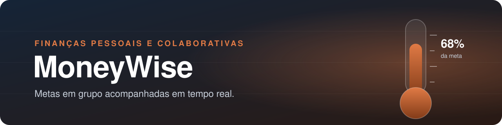
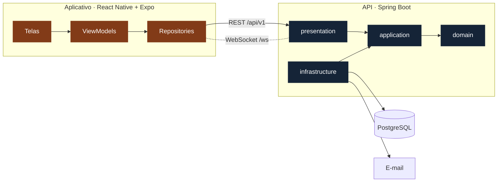
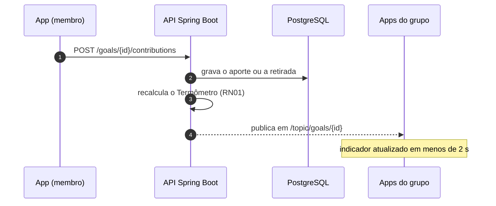

<div align="center">



<br />
<br />


<br />
<br />


**[Visão geral](#visão-geral)** &nbsp;·&nbsp;
**[Funcionalidades](#funcionalidades)** &nbsp;·&nbsp;
**[Arquitetura](#arquitetura)** &nbsp;·&nbsp;
**[Como executar](#como-executar)** &nbsp;·&nbsp;
**[Roadmap](#roadmap)** &nbsp;·&nbsp;
**[Documentação](#documentação)**

<sub>Trabalho de Conclusão de Curso · Engenharia de Software · Universidade Católica de Brasília</sub>

</div>

---

## Visão geral

O **MoneyWise** é um aplicativo de finanças pessoais e colaborativas para jovens adultos, casais e famílias. Cada pessoa controla as próprias receitas e despesas e, junto com outras, cria **Caixinhas**: metas financeiras compartilhadas dentro de um grupo.

<table>
<tr>
<td width="25%" align="center" valign="top">
<br />
<strong>Termômetro</strong><br />
<sub>Progresso de cada meta, atualizado em tempo real para todo o grupo.</sub>
</td>
<td width="25%" align="center" valign="top">
<br />
<strong>Caixinhas em grupo</strong><br />
<sub>Metas compartilhadas com convite por código, aportes e retiradas.</sub>
</td>
<td width="25%" align="center" valign="top">
<br />
<strong>Privacidade</strong><br />
<sub>O saldo pessoal nunca é exibido ao grupo.</sub>
</td>
<td width="25%" align="center" valign="top">
<br />
<strong>Uso sem internet</strong><br />
<sub>Registro offline com sincronização automática.</sub>
</td>
</tr>
</table>

O sistema é composto por um **aplicativo móvel** (Android e iOS), uma **API REST própria** e um **banco de dados relacional** com esquema versionado. Nesta versão, o aplicativo **não será publicado nas lojas**: ele é executado e apresentado pelo Expo.

---

## Funcionalidades

### MVP (Release 1)

| Módulo | Escopo |
|---|---|
| **Conta e acesso** | Cadastro com aceite dos Termos de Uso, verificação do e-mail por código, login com "Lembrar de mim", recuperação de senha por código, logout e exclusão da conta |
| **Transações** | Cadastro, edição, exclusão e filtros por categoria e período, com categorias fixas e categorias próprias |
| **Painel** | Saldo, entradas e saídas do mês e gastos por categoria |
| **Modo offline** | Registro sem internet com sincronização automática na reconexão |
| **Grupos** | Caixinhas compartilhadas ou individuais, convite por código válido por 7 dias, papéis Admin e Membro |
| **Caixinhas** | Metas com valor e prazo, aportes, retiradas e histórico por membro |
| **Termômetro** | Progresso da meta atualizado em tempo real para todo o grupo |

### Release 2

Calendário financeiro · Histórico agrupado por mês · Relatório mensal em PDF · Alertas de orçamento (80% do limite) · Lembretes por notificação push · Cálculos na moeda do perfil

<details>
<summary><strong>Regras de negócio</strong></summary>

<br />

| Regra | Descrição | Entrega |
|---|---|---|
| RN01 | O Termômetro é calculado no servidor a partir do valor acumulado, do valor da meta e do prazo restante. | MVP |
| RN02, RN08 | Dados financeiros pessoais não são expostos ao grupo. | MVP |
| RN03 | Transações de meses fechados não podem ser editadas nem excluídas. | MVP |
| RN04 | Só o Admin cria e edita metas, convida e remove membros. Se o Admin sair, outro membro assume. | MVP |
| RN06 | Cada e-mail pode ser usado em apenas uma conta. | MVP |
| RN10 | O aplicativo não será publicado nas lojas nesta versão. | MVP |
| RN11 | O código de convite vale por 7 dias. | MVP |
| RN12 | A Caixinha individual é um grupo com um único membro. | MVP |
| RN13 | Ao excluir a conta, os dados pessoais são apagados e o histórico do grupo é mantido sem o nome. | MVP |
| RN05 | Alerta visual ao atingir 80% do limite de uma categoria. | Release 2 |
| RN07 | Lembretes apenas após 24 horas sem uso. | Release 2 |
| RN09 | Cálculos na moeda definida no perfil. | Release 2 |

A especificação completa está no [Documento de Requisitos](docs/documentos/documento-requisitos-v2.1.pdf).

</details>

---

## Arquitetura

Arquitetura **cliente-servidor** em um **monorepo**. O aplicativo segue **MVVM com Repository**, e a API segue **Clean Architecture**, com as camadas `domain`, `application`, `infrastructure` e `presentation` em cada funcionalidade.



### Stack

| Camada | Tecnologias |
|---|---|
| Aplicativo | React Native, Expo, TypeScript, React Navigation, SecureStore, STOMP |
| API | Java 21, Spring Boot, Spring Security, JWT com refresh token, BCrypt, WebSocket/STOMP, springdoc |
| Dados | PostgreSQL, Flyway |
| Serviços | Envio de e-mail (Resend) · Firebase Cloud Messaging (Release 2) |
| Qualidade | JUnit, Testcontainers, ArchUnit · Jest e React Native Testing Library (planejado) |
| Infraestrutura | Docker, Docker Compose, Expo Go · hospedagem em nuvem a definir |

### Termômetro em tempo real



A inscrição no tópico exige JWT válido e é restrita aos membros do grupo.

<details>
<summary><strong>Diagramas</strong></summary>

<br />

| Diagrama | |
|---|---|
| Arquitetura geral |  |
| Contexto (C4, nível 1) |  |
| Containers (C4, nível 2) |  |
| Modelo entidade-relacionamento |  |
| Fluxo de navegação |  |
| Implantação |  |

</details>

<details>
<summary><strong>Endpoints da API</strong></summary>

<br />

Prefixo `/api/v1`. Com a API no perfil `dev`, a documentação interativa fica em `http://localhost:8080/swagger-ui/index.html`. Contrato versionado: [`docs/api/openapi.yaml`](docs/api/openapi.yaml).

| Recurso | Endpoints |
|---|---|
| Autenticação | `POST /auth/register` `/auth/verify-email` `/auth/resend-verification` `/auth/login` `/auth/refresh` `/auth/logout` |
| Recuperação de senha | `POST /auth/password/forgot` `/auth/password/verify-code` `/auth/password/reset` |
| Transações | `POST` `GET /transactions` · `PUT` `DELETE /transactions/{id}` |
| Relatórios | `GET /reports/monthly` |
| Grupos | `POST` `GET /groups` · `GET /groups/{id}` · `POST /groups/{id}/invitations` · `DELETE /groups/{id}/members/{memberId}` · `DELETE /groups/{id}/members/me` |
| Convites | `GET /invitations/{code}` · `POST /invitations/{code}/accept` |
| Metas | `POST /groups/{groupId}/goals` · `GET /goals` · `GET` `PUT` `DELETE /goals/{id}` · `POST /goals/{id}/archive` `/unarchive` · `POST` `GET /goals/{id}/contributions` · `GET /goals/{id}/thermometer` |
| Tempo real | WebSocket `/ws` · tópico `/topic/goals/{id}` |

Em desenvolvimento: exclusão da conta (MVP). Release 2: calendário, PDF, alertas e notificações.

</details>

<details>
<summary><strong>Estrutura do repositório</strong></summary>

<br />

```
moneywise/
├── backend/        API em Java 21 e Spring Boot
│   └── src/main/java/com/moneywise/
│       ├── shared/          configuração, exceções e tipo monetário
│       ├── auth/            cada módulo: domain/ application/ infrastructure/ presentation/
│       ├── transactions/
│       ├── groups/
│       ├── goals/
│       ├── reports/
│       └── notifications/   reservado para a Release 2
├── mobile/         aplicativo em React Native, Expo e TypeScript
│   └── src/
│       ├── core/            api, navigation, realtime, storage, theme, utils
│       └── features/        auth, onboarding, transactions, reports, goals
├── docs/           contrato da API, decisões, documentos oficiais e imagens
├── docker-compose.yml
├── .env.example
└── CONTRIBUTING.md
```

</details>

---

## Como executar

> O guia completo, testado do zero com o aplicativo conectado à API, será publicado na task QA-03.

**Pré-requisitos:** Git, Docker Desktop, Node.js (LTS), Expo Go no celular ou um emulador. JDK 21 apenas para rodar a API fora do Docker (o projeto usa o Maven Wrapper).

**1. Clonar e configurar**

```bash
git clone https://github.com/anetef/MoneyWise.git
cd MoneyWise
cp .env.example .env   # defina DB_PASSWORD e JWT_SECRET (openssl rand -base64 48)
```

Com `MAIL_PROVIDER=log` (padrão), os códigos de e-mail aparecem no log da API.

**2. Subir banco e API**

```bash
docker compose up --build
```

A API fica em `http://localhost:8080` e aplica as migrations do Flyway automaticamente.

<details>
<summary>Rodar a API pelo Maven (desenvolvimento do backend)</summary>

```bash
docker compose up -d postgres
set -a; source .env; set +a
cd backend && ./mvnw spring-boot:run
```

</details>

**3. Rodar o aplicativo**

Crie `mobile/.env.local` com o endereço da API (no celular, use o IP do computador na rede):

```bash
EXPO_PUBLIC_API_URL=http://192.168.0.10:8080/api/v1
```

```bash
cd mobile
npm install
npx expo start
```

**Testes da API**

```bash
cd backend && ./mvnw test   # requer o Docker aberto (Testcontainers)
```

> `docker compose down -v` apaga o volume e todos os dados do banco local.

---

## Roadmap

Acompanhamento no quadro [MoneyWise — Desenvolvimento](https://github.com/users/anetef/projects/2).

| Etapa | Escopo | Status |
|---|---|---|
| M0 · Fundação | Monorepo, Docker, projetos base, tema e navegação |  |
| M1 · Autenticação | Cadastro, verificação, login, sessão, recuperação de senha e exclusão da conta |  |
| M2 · Transações | Transações, Dashboard, Extrato e sincronização offline |  |
| M3 · Grupos e Caixinhas | Grupos, convites, metas, aportes, retiradas e Termômetro |  |
| MVP · v1.0.0 | Testes de segurança, roteiro ponta a ponta e release na `main` |  |
| M4 · Release 2 | Calendário, PDF, alertas, notificações e hospedagem em nuvem |  |

---

## Contribuição

Uma task, uma branch, uma Pull Request. Branches `feature/<ID>-<descricao>` a partir da `develop`, commits em [Conventional Commits](https://www.conventionalcommits.org/pt-br/) em português, `Refs #n` na descrição da PR, uma aprovação antes do merge e merge commit. O passo a passo e a Definition of Done estão no [CONTRIBUTING.md](CONTRIBUTING.md).

---

## Equipe

| Integrante | Área |
|---|---|
| Ana Eduarda Raposo Medeiros | Aplicativo móvel |
| Anette Stefany Villalba Palomino | Aplicativo móvel |
| Brunno Calado Cavalcante | Backend |
| Débora Cristina Silva Ferreira | Backend |
| Agatha Karenne De Andrade Machado | Organização, documentação e testes |
| Clarice Christine Soares Viana | Organização, documentação e testes |

---

## Documentação

| Documento | Descrição |
|---|---|
| [Documento de Visão v2.1](docs/documentos/documento-visao-v2.1.pdf) | Problema, público-alvo, necessidades e requisitos não funcionais |
| [Documento de Requisitos v2.1](docs/documentos/documento-requisitos-v2.1.pdf) | RF-01 a RF-36, RN01 a RN13, casos de uso, modelo de dados e protótipo |
| [Roteiro de Testes v1.1](docs/documentos/roteiro-testes-v1.1.pdf) | Estratégia e casos de teste ponta a ponta |
| [Termos de Uso e Política de Privacidade v1.0](docs/documentos/termos-uso-privacidade-v1.0.pdf) | Texto exibido no cadastro |
| [Decisões de arquitetura](docs/architecture/) | Registros das decisões técnicas |
| [Contrato da API](docs/api/openapi.yaml) | Especificação OpenAPI |

---

<div align="center">
<sub>Projeto acadêmico · Universidade Católica de Brasília · 2026</sub>
</div>
